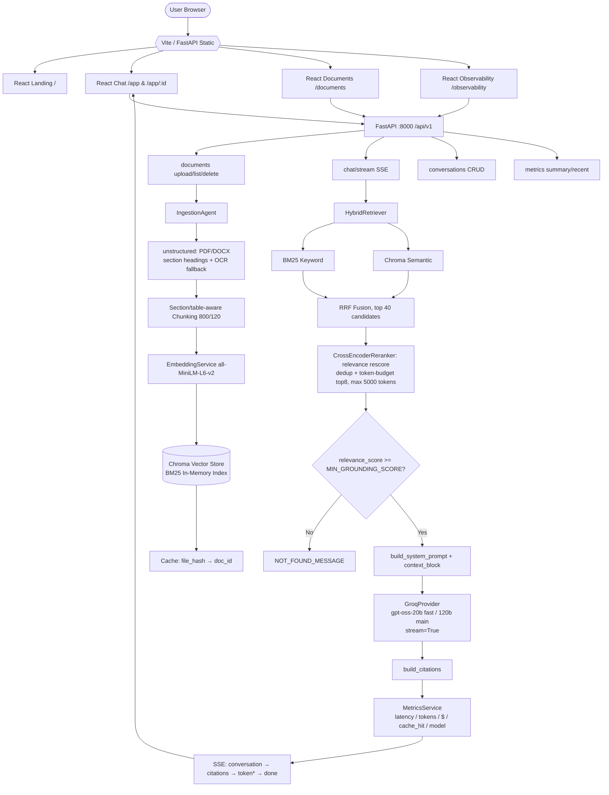
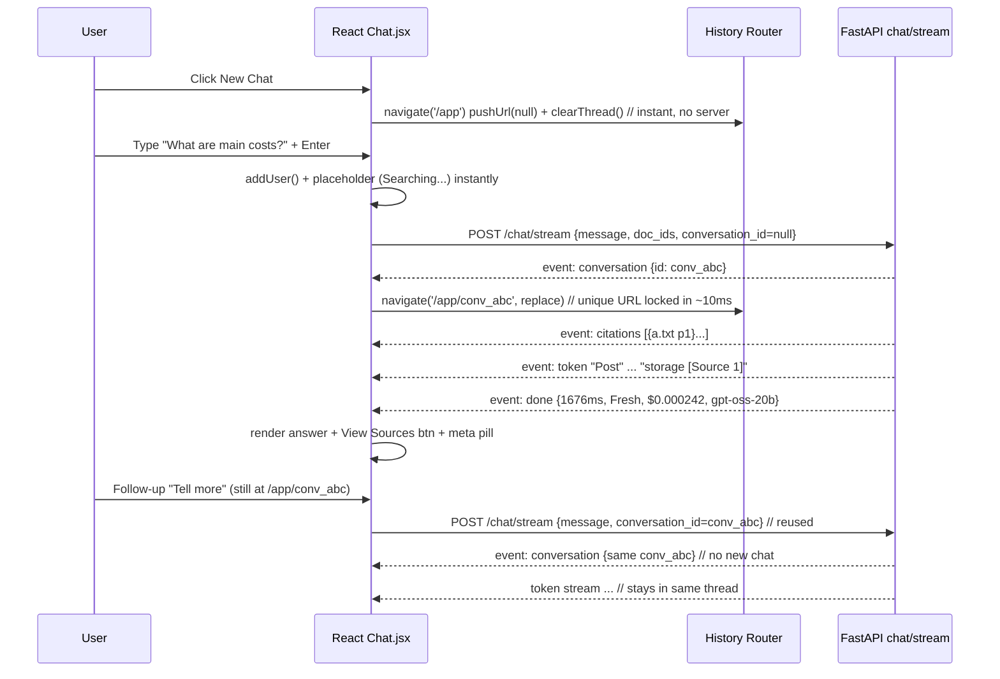
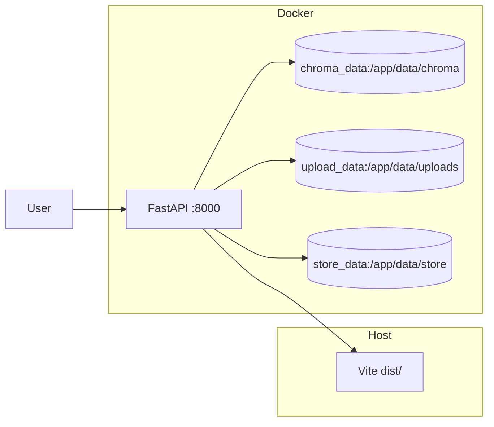

# Domain Knowledge Bot — Architecture

> **Stack:** React (Vite + React Router) + FastAPI + Chroma + BM25 + Groq (gpt-oss-20b/120b) + sentence-transformers
> **Live:** `http://0.0.0.0:8000/app` — each chat has unique URL `/app/<id>`, instant new-chat, sources in blur modal
> **Repo:** https://github.com/its-yashjai/grounded-rag-bot.git
> **Generated for** `grounded-rag-bot`.

---

## 1) Overall System



**Notes:**
- Frontend `dist/` served by FastAPI (`backend/app/main.py` serves Vite `dist/` if present, fallback to legacy `frontend/`; SPA fallback for `/app/:id`).
- `lifespan` restores Chroma/BM25 from disk on startup so uploads survive restarts.

---

## 2) RAG Pipeline (Ingest → Query)

```mermaid
flowchart LR
    A[Upload PDF/DOCX/TXT] --> B[Extract<br/>page numbers preserved]
    B --> C[Chunk<br/>paragraph-aware 800±120 overlap]
    C --> D[Embed<br/>batch + content-hash cache]
    D --> E[(Chroma Persist<br/>./data/chroma)]
    D --> F[(BM25 Index<br/>in-memory)]

    G[User Query] --> H[normalize_query<br/>router_agent is_complex?]
    H --> I{Fast or Main?}
    I -- simple --> J1[gpt-oss-20b]
    I -- complex --> J2[gpt-oss-120b]
    H --> K[Hybrid Retrieve top40]
    K --> L[BM25 + Vector → RRF]
    L --> M[Cross-Encoder Rerank dedup top8]
    M --> N{Guard}
    N -- insufficient --> O[Refuse: not in docs]
    N -- sufficient --> P[System Prompt<br/>“use only context, cite [Source N]”]
    P --> Q[Groq Stream]
    Q --> R[Answer + Sources<br/>cost/latency/model]
```

**Details from `README.md` + code:**
- **Extraction** (`services/ingestion/extractor.py`): `unstructured` for PDF/DOCX — section headings via `parent_id` chains, table detection (opt-in, `ENABLE_TABLE_EXTRACTION`), OCR fallback for scanned pages.
- **Chunking** (`services/ingestion/chunker.py`): packs blocks up to `CHUNK_SIZE`, never merging across a section boundary or into a table, only hard-splits an oversized single block, 120 token overlap correctly carried across flushes.
- **Embedding cache** (`services/cache`): `chunk_hash → embedding`, avoids re-embedding identical text.
- **Reranking** (`services/retrieval/reranker.py`): dedup by content hash, `CrossEncoderReranker` rescores every candidate against the query (sigmoid-calibrated to a 0-1 `relevance_score`), select top `RERANK_TOP_K` within `MAX_CONTEXT_TOKENS` (5000). Falls back to plain RRF-score selection if `ENABLE_CROSS_ENCODER_RERANKER=false`.
- **Guard** (`agents/answer_agent.py:has_sufficient_grounding`): `relevance_score >= MIN_GROUNDING_SCORE` when the cross-encoder ran; falls back to a looser RRF fused-score threshold otherwise.
- **Cost routing** (`agents/router_agent.py:is_complex_query`): no extra LLM call.

---

## 3) Frontend React Architecture (Vite Build)

```mermaid
graph TB
    Browser --> Vite[ Vite React SPA dist/ ]
    Vite --> Router[BrowserRouter]
    Router --> LandingPage[/ Landing]
    Router --> ChatPage[/app & /app/:id<br/>Chat.jsx]
    Router --> DocsPage[/documents<br/>Documents.jsx]
    Router --> ObsPage[/observability<br/>Observability.jsx]

    ChatPage --> Sidebar[Sidebar.jsx<br/>New chat instant<br/>search + groups by time]
    ChatPage --> Topbar[Topbar.jsx<br/>title + /app/id + Copy link<br/>gpt-oss routed + Upload]
    ChatPage --> Greet[Landing-hero when empty<br/>stats + suggestions + feature-grid]
    ChatPage --> Thread[Thread<br/>msg.user bubble + msg.assistant card]
    Thread --> SourcesBtn[View Sources (N)<br/>→ sources-modal]
    Thread --> Meta[msg-meta pill<br/>1676ms · Cached/Fresh · $0.000242 · model]

    SourcesBtn --> Modal[sources-modal-overlay<br/>blur 8px + cost/cached/model]
    Modal --> Cards[source-card<br/>filename p.X excerpt]

    Sidebar --> APIjs[api.js<br/>streamChat SSE parser]
    ChatPage --> APIjs
    DocsPage --> APIjs
    ObsPage --> APIjs
    APIjs --> Backend[FastAPI /api/v1]
```

**Key frontend fixes (vs vanilla):**
- `Chat.jsx:9` `justCreatedRef` skips refetch that overwrote streaming answer
- `api.js` tracks `gotDone` + 429 retry with `6s` (Groq `Please try again in 5.4s`)
- `Topbar.jsx` `Copy link` works on `http` via `execCommand` fallback + toast
- `vite.config.js` proxies `/api → 8000`

---

## 4) Sequence: New Chat + Follow-up (Same URL, No Fork)



---

## 5) Deployment



**Docker:** `docker-compose.yml` builds `backend/Dockerfile`, mounts `chroma_data`, `upload_data`, `store_data` volumes, `env_file: backend/.env`.

---

## 6) Tech Stack & Directory

**Frontend:**
```
frontend/
  vite.config.js (proxy /api → 8000)
  src/
    App.jsx (BrowserRouter /, /app, /app/:id, /documents, /observability)
    App.css + index.css (warm theme: --bg #FDFCF9, --accent #C26A2B)
    api.js (streamChat SSE parser, gotDone guard)
    utils/markdown.js + toast.js
    components/Sidebar.jsx, Topbar.jsx
    pages/Chat.jsx (instant new chat, same-chat guard, sources modal blur, meta pill)
         Landing.jsx (hero + pipeline)
         Documents.jsx (dropzone + stats + toast ✓ Uploaded)
         Observability.jsx (polls /metrics every 3s)
```

**Backend:**
```
backend/app/
  main.py (serves Vite dist/, SPA fallback for /app/:id, lifespan restores Chroma/BM25)
  config.py (.env GROQ_API_KEY, CHUNK_SIZE 800 etc.)
  deps.py (singletons: Chroma, BM25, Embedding, Retriever, Reranker, Groq)
  agents/ ingestion_agent, query_agent, answer_agent (has_sufficient_grounding), router_agent
  services/ llm/groq_service (AsyncGroq stream, retry 6s for 429), embeddings, retrieval, cache, cost, citations, observability/metrics_service
  repositories/ vectors (Chroma), documents (JSON), conversations (SQLite)
  api/v1/ chat (SSE), documents, conversations, metrics, health
```

**Env:** `GROQ_API_KEY=gsk_…`, `GROQ_MODEL=openai/gpt-oss-120b`, `GROQ_FAST_MODEL=openai/gpt-oss-20b`, `EMBEDDING_MODEL=all-MiniLM-L6-v2`

---

## 7) Caching & Observability

- **Four caches** (`services/cache/cache_service.py`): `file_hash→doc_id`, `chunk_hash→embedding`, `response:kb_version+sha256(query+doc_ids)→answer+citations` (auto-invalidated via `kb_version` on uploads), retrieval cache.
- **Metrics** (`services/observability/metrics_service.py`): every `POST /chat/stream` logs `latency_ms`, `cache_hit`, `retrieved/reranked`, `input/output tokens`, `estimated_cost_usd`, `model` → `GET /metrics` (recent 50) + `/metrics/summary` (avg latency, hit rate, total cost). Frontend shows `1676ms · Fresh · $0.000242 · gpt-oss-20b` per answer.

---
